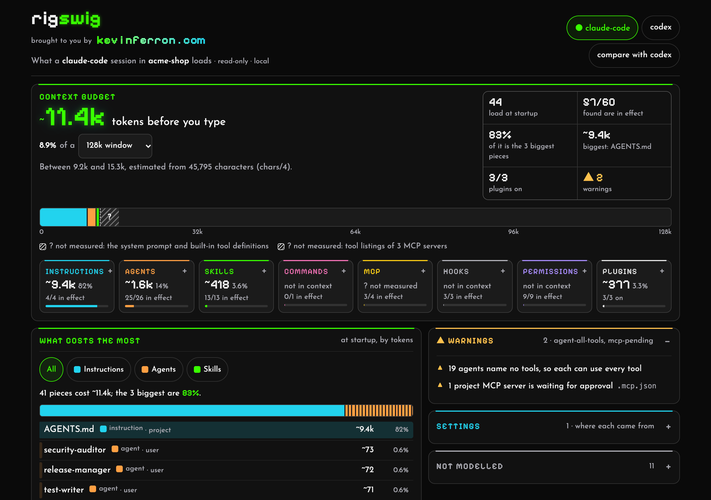
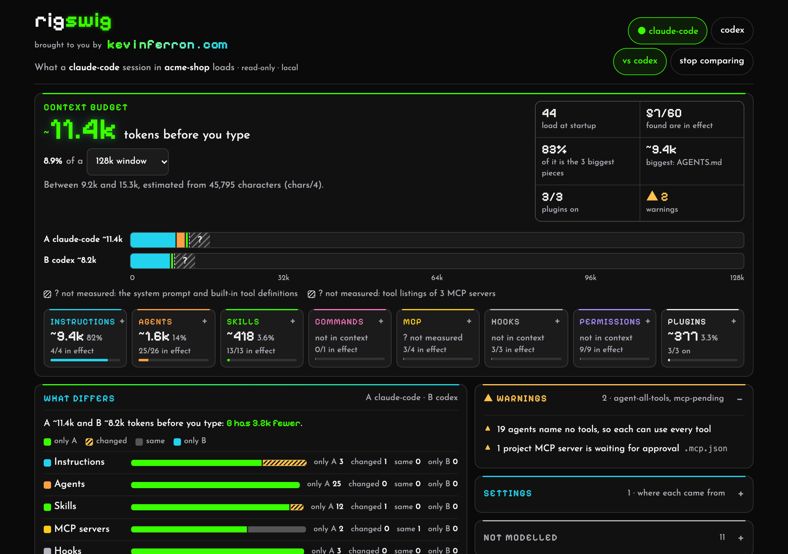
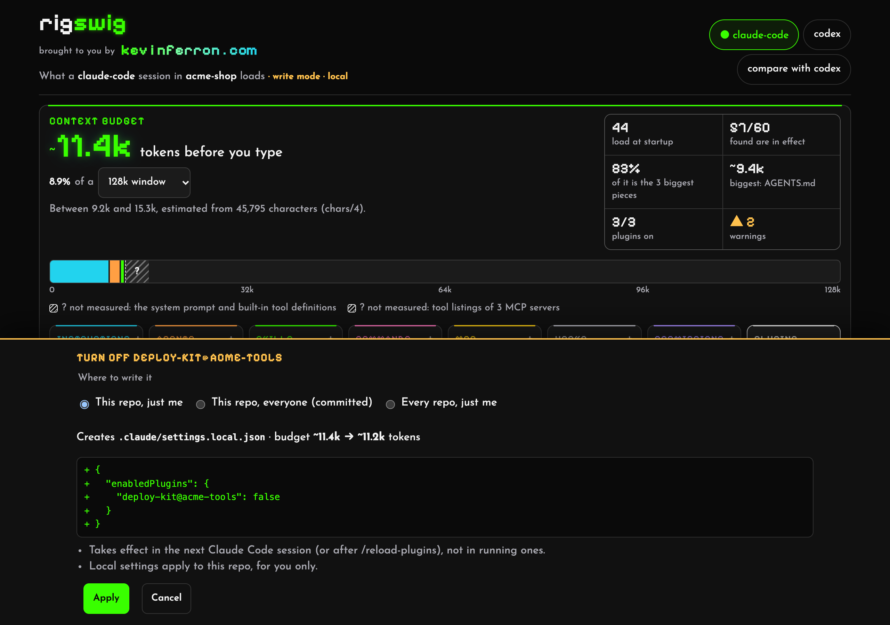
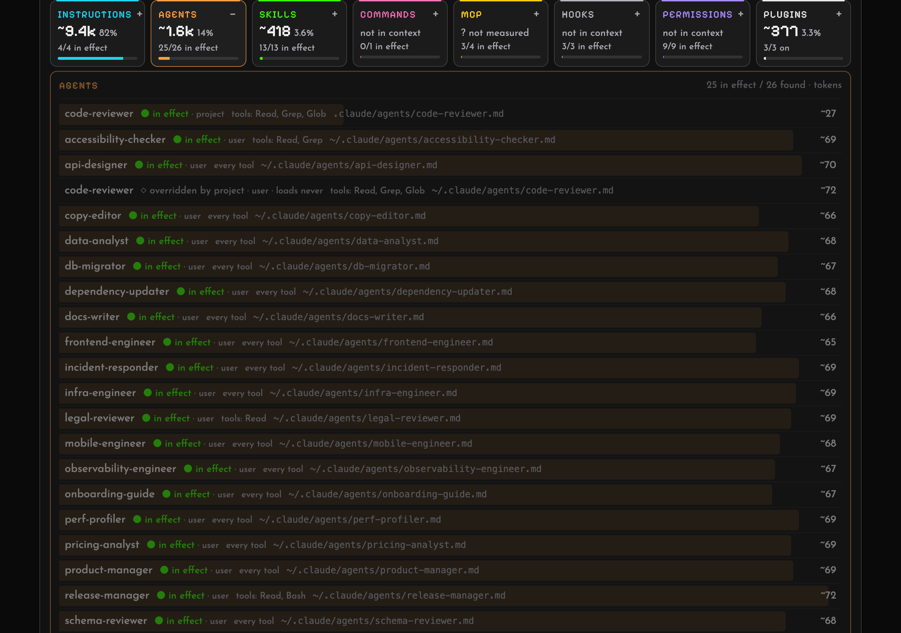

# rigswig

See everything your coding agent loads before you type, and where each piece came from.



<table>
  <tr>
    <td width="50%"></td>
    <td width="50%"></td>
  </tr>
  <tr>
    <td><b>Compare</b> two harnesses on one repo (or two repos): Codex cuts this <code>AGENTS.md</code> at its 32&nbsp;KiB budget.</td>
    <td><b>Write mode</b> (opt-in): every change shows the file, the diff and the new budget first, with a backup and undo.</td>
  </tr>
</table>



<sub>Screenshots of an invented setup, rebuilt with <code>docs/demo/make-demo.sh</code>.</sub>

A coding agent's **harness** is everything around the model: instruction files (`CLAUDE.md`, `AGENTS.md`,
`GEMINI.md`, rules), subagents, skills, commands, hooks, MCP servers, plugins, permissions and the model setting,
spread across user, project, local and managed scopes. rigswig reads all of it for a repo and shows what a session
there actually gets, which scope decided each setting, what is overridden, and roughly how much context it costs
before you type a word.

**Status: pre-alpha.** `rigswig status` and the local page, `rigswig ui`, work for Claude Code and Codex. See
[docs/ROADMAP.md](docs/ROADMAP.md).

rigswig is a single binary written in Rust. Once released it will install with `cargo install rigswig`, Homebrew or
`npx rigswig`; until then, build it from source:

```sh
cargo run -- status --repo path/to/repo          # a summary
cargo run -- status --repo path/to/repo --json   # everything, as schema/harness.schema.json describes
cargo run -- ui --repo path/to/repo              # the same as a page on 127.0.0.1, behind a random token
cargo run -- compare repo-a repo-b               # what differs between two repos, one harness
cargo run -- compare path/to/repo --tools claude-code,codex   # or between two harnesses on one repo
cargo run -- check --repo path/to/repo --max-tokens 40k        # for CI: exit 1 when the budget is passed
cargo run -- status --repo path/to/repo --without layer:user   # what-if: the totals without some items
```

The page is local: it listens on 127.0.0.1 only, answers only requests that carry its token and the right `Host`,
loads nothing from anywhere else, and stops after 30 minutes without a request. It is read-only unless started with
`--allow-writes`, which lets it turn plugins and project MCP servers on and off, each with a preview (the file, the
diff, the budget before and after), a backup and undo: see [docs/WRITE-MODE.md](docs/WRITE-MODE.md).

## Guarantees

These are the point of the tool, and they will be enforced by tests:

- **No network.** rigswig never makes a request, and sends no telemetry.
- **No model calls.** Everything it shows is read from files on your machine.
- **Read-only by default.** Nothing is ever written unless you start the page with `rigswig ui --allow-writes`
  ([write mode](docs/WRITE-MODE.md)).
- **No secrets.** MCP server `env`, `headers` and `args`, URL paths and inline hook code are never printed or served.
- **No transcripts.** It never reads session history.

## Harnesses

Harness-agnostic: each harness is an adapter that reads its own files into one shared data model.

| Harness | Status |
|---|---|
| Claude Code | `rigswig status` ([the rules it models](docs/adapters/claude-code.md)) |
| OpenAI Codex CLI | `rigswig status --tool codex` ([the rules it models](docs/adapters/codex.md)) |
| Gemini CLI | planned |
| GitHub Copilot (repo files) | planned |
| Cursor, OpenCode, others | adapters welcome |

## Related tools

Other tools work on the same question, and are worth a look:
[harness-map](https://github.com/codemakim/harness-map) (Codex and Claude Code, with a what-if mode),
[whatloads](https://github.com/sheldor26/whatloads) (Claude Code's context bill),
[claude-config-auditor](https://github.com/emreyildirim/claude-config-auditor) (lint and CI), and Claude Code's own
`/context`.

## Licence

[Apache-2.0](LICENSE).
