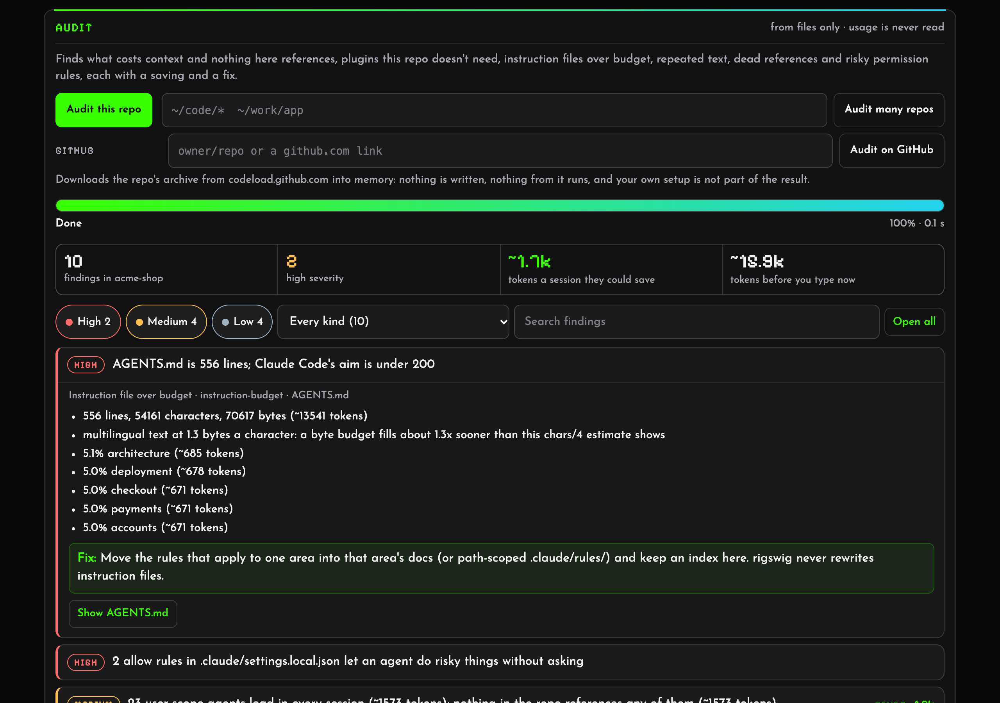
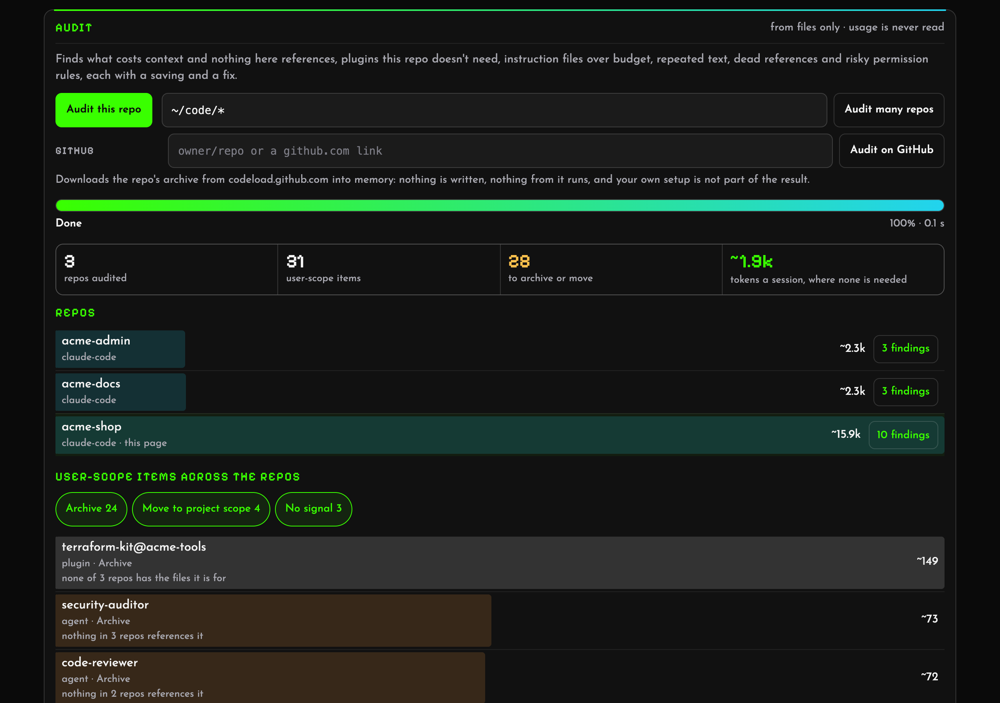

# rigswig

See everything your coding agent loads before you type, and where each piece came from.


<table>
  <tr>
    <td width="50%"></td>
    <td width="50%"></td>
  </tr>
  <tr>
    <td><b>Compare</b> two harnesses on one repo (or two repos): Codex cuts this <code>AGENTS.md</code> at its 32&nbsp;KiB budget.</td>
    <td><b>Write mode</b> (opt-in): every change shows the file, the diff and the new budget first, with a backup and undo.</td>
  </tr>
</table>


<table>
  <tr>
    <td width="50%"></td>
    <td width="50%"></td>
  </tr>
  <tr>
    <td><b>Audit</b> a repo: ranked findings, each with its evidence, the tokens it would save and a fix. Filter them, and open the items they name.</td>
    <td><b>Fleet mode</b> across many repos: which user-scope agents, skills and plugins any repo needs, and what to archive or move to project scope.</td>
  </tr>
</table>

<sub>Screenshots of an invented setup, rebuilt with <code>docs/demo/make-demo.sh</code> (the audit's with <code>docs/demo/shoot.mjs</code>).</sub>

A coding agent's **harness** is everything around the model: instruction files (`CLAUDE.md`, `AGENTS.md`,
`GEMINI.md`, rules), subagents, skills, commands, hooks, MCP servers, plugins, permissions and the model setting,
spread across user, project, local and managed scopes. rigswig reads all of it for a repo and shows what a session
there actually gets, which scope decided each setting, what is overridden, and roughly how much context it costs
before you type a word.

**Status: 0.1, pre-1.0.** `rigswig status`, `rigswig audit` and the local page, `rigswig ui`, work for Claude Code,
Codex, Hermes Agent and Ollama. See [docs/ROADMAP.md](docs/ROADMAP.md).

rigswig is a single binary written in Rust. Install it with `cargo install rigswig`
([crates.io](https://crates.io/crates/rigswig); add `--no-default-features` for a build with no network code), or
download it for macOS, Linux or Windows from [the releases](https://github.com/overfocus/rigswig/releases), each with
a `SHA256SUMS` line to check it against. Homebrew and `npx rigswig` are not set up yet. From a checkout:

```sh
cargo run -- status --repo path/to/repo          # a summary
cargo run -- status --repo path/to/repo --json   # everything, as schema/harness.schema.json describes
cargo run -- ui --repo path/to/repo              # the same as a page on 127.0.0.1, behind a random token
cargo run -- compare repo-a repo-b               # what differs between two repos, one harness
cargo run -- compare path/to/repo --tools claude-code,codex   # or between two harnesses on one repo
cargo run -- check --repo path/to/repo --max-tokens 40k        # for CI: exit 1 when the budget is passed
cargo run -- status --repo path/to/repo --without layer:user   # what-if: the totals without some items
cargo run -- audit --repo path/to/repo                          # ranked findings, each with a saving and a fix
cargo run -- audit --repos '~/code/*'                           # fleet: each user-scope item against every repo
cargo run -- audit --github owner/repo                          # a public GitHub repo, in memory, without your setup
cargo run -- audit --archive repo.tar.gz                        # the same for an archive you downloaded, offline
```

`rigswig audit` turns the numbers into a to-do list: user-scope agents and skills that nothing in the repo references,
plugins switched on everywhere that the repo's files don't call for, instruction files over budget, sentences repeated
across layers, paths and scripts the instructions name that don't exist, and permission rules that have piled up or
allow too much. Each finding carries its evidence, the tokens it would save (computed like `--without`) and a proposed
change. Fleet mode answers the question a single repo can't: which repos need each user-scope item, so it can move to
those repos' project scope. The page runs both too, with a progress bar, and lets you filter the findings and jump
from one to the items it names. See [docs/AUDIT.md](docs/AUDIT.md).

The page is local: it listens on 127.0.0.1 only, answers only requests that carry its token and the right `Host`,
loads nothing from anywhere else, and stops after 30 minutes without a request. It is read-only unless started with
`--allow-writes`, which lets it turn plugins and project MCP servers on and off, each with a preview (the file, the
diff, the budget before and after), a backup and undo: see [docs/WRITE-MODE.md](docs/WRITE-MODE.md).

## Guarantees

These are the point of the tool, and they will be enforced by tests:

- **No network unless you ask.** rigswig sends no telemetry and makes no request, except one: `--github owner/repo`
  downloads that public repo's archive from `codeload.github.com`, only in the run you give it to, or for each
  GitHub audit you start on a page launched with `ui --allow-github` ([GitHub repos](docs/GITHUB.md)). Build with
  `--no-default-features` for a rigswig with no network code at all.
- **No model calls.** Everything it shows is read from files on your machine.
- **Read-only by default.** Nothing is ever written unless you start the page with `rigswig ui --allow-writes`
  ([write mode](docs/WRITE-MODE.md)).
- **No secrets.** MCP server `env`, `headers` and `args`, URL paths and inline hook code are never printed or served.
- **No transcripts.** It never reads session history. (Claude Code's auto-memory index, `MEMORY.md`, is read and
  counted because it loads into every session; nothing else in that folder is.)
- **Private folders stay private.** List them in `~/.rigswig/private.json` (`{"private": ["~/notes"]}`): rigswig
  refuses them as a repo, and `audit --repos` skips them.

## Harnesses

Harness-agnostic: each harness is an adapter that reads its own files into one shared data model.

| Harness | Status |
|---|---|
| Claude Code | `rigswig status` ([the rules it models](docs/adapters/claude-code.md)) |
| OpenAI Codex CLI | `rigswig status --tool codex` ([the rules it models](docs/adapters/codex.md)) |
| Hermes Agent | `rigswig status --tool hermes` ([the rules it models](docs/adapters/hermes.md)) |
| Ollama | `rigswig status --tool ollama` ([the rules it models](docs/adapters/ollama.md)) |
| Gemini CLI | planned |
| GitHub Copilot (repo files) | planned |
| Cursor, OpenCode, others | adapters welcome |

## Related tools

Other tools work on the same question, and are worth a look:
[harness-map](https://github.com/codemakim/harness-map) (Codex and Claude Code, with a what-if mode),
[whatloads](https://github.com/sheldor26/whatloads) (Claude Code's context bill),
[claude-config-auditor](https://github.com/emreyildirim/claude-config-auditor) (lint and CI), and Claude Code's own
`/context`.

## Licence

[Apache-2.0](LICENSE).
